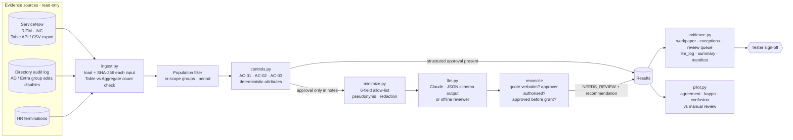

# SOX ITGC Evidence Review (Claude-assisted, human-in-the-loop)

**Automates the evidence checks behind a monthly SOX IT general control (ITGC) access audit.**
It tests every access grant, termination and emergency-access event against ServiceNow tickets.
Claude reads only the free-text notes that rules cannot interpret, and the output is a tester-ready
workpaper with checksums. A person signs off every result.

> **Provenance.** This is a portfolio reference implementation of an approach I built and run as a
> Senior Systems Specialist. There, a Claude-assisted review of ServiceNow RITM and incident exports
> matched the manual review 100% in a side-by-side pilot. **This repository contains no employer code,
> data, configuration or ticket content.** Everything here was written from scratch for the portfolio,
> and it runs on a seeded, fully fictional dataset (`scripts/generate_synthetic.py`).

## Why

A monthly access audit means opening every in-scope ticket and checking the same things: Was there a request?
Was it approved? Did the approval come before the change? Was the approver allowed to approve it? Was it someone other than the requester and the
fulfiller? Most of that is structured data and needs no judgment. The slow part is the minority of tickets where approval
lives only in a work note ("approved by email, attached"). This tool:

1. **Tests structured attributes with plain rules**, so the result is explainable and repeatable,
2. **sends only the unclear tickets to Claude**, minimised and pseudonymised, to extract *facts* (who approved, in what role, when, and the exact quote),
3. **checks those facts again in code**: the quote must appear verbatim in the notes, the approver must be authorised, and the approval time must be before the grant,
4. **never lets the model pass an item on its own.** Note-based items always go to a tester with a recommendation, and
5. **writes an evidence pack** (workpaper, exceptions, review queue, LLM log, SHA-256 manifest) that an auditor can re-perform.

## Architecture



## Controls tested

| Control | Population | Attributes |
|---|---|---|
| **AC-01** Access provisioning | Every add to a SOX in-scope group in the period (not emergency) | A1 ticket exists · A2 ticket matches user and group · A3 approval recorded · A4 approved before provisioning · A5 segregation of duties (approver ≠ recipient, ≠ fulfiller) · A6 approver is the manager or group owner |
| **AC-02** Terminations | Every termination in the period | B1 account disabled · B2 within 24 h (voluntary) / 4 h (involuntary) · B3 leaver ticket exists |
| **AC-03** Emergency access | Every add linked to an incident | C1 P1/P2 incident · C2 group owner's retrospective approval within 48 h · C3 access removed within 7 days |

Full matrix with risks, assertions and evidence: [docs/control-matrix.md](docs/control-matrix.md).

## Quick start

```bash
python3 scripts/generate_synthetic.py --out data/synthetic --period 2026-10 --seed 7
python3 -m soxreview run --data data/synthetic --period 2026-10 --out out/2026-10 \
        --manual data/synthetic/manual_review.csv              # offline reviewer, no API key needed
python3 -m unittest discover -s tests -v
```

Output on the bundled synthetic dataset:

```text
Tested 176 items for 2026-10; 6 sent to reviewer 'offline-rules'.
  AC-01: PASS 118  EXCEPTION  10  NEEDS_REVIEW   6
  AC-02: PASS  32  EXCEPTION   4  NEEDS_REVIEW   0
  AC-03: PASS   4  EXCEPTION   2  NEEDS_REVIEW   0
Pilot: 176/176 agree with manual review (100.0%, kappa 1.000).
Evidence pack: out/2026-10
```

Using Claude for the note review (Anthropic Python SDK, `claude-opus-5-5`, structured JSON output, server-side refusal fallback):

```bash
pip install anthropic
export ANTHROPIC_API_KEY=...            # or: ant auth login
export SOXREVIEW_SALT="$(openssl rand -hex 16)"   # new pseudonymisation salt each cycle
python3 -m soxreview run --data data/synthetic --period 2026-10 --out out/2026-10 \
        --reviewer claude --manual data/synthetic/manual_review.csv
```

Pulling RITMs straight from ServiceNow (read-only GETs, OAuth bearer token):

```bash
export SN_TOKEN=...   # integration user with read-only roles on sc_req_item
python3 -m soxreview pull --instance <instance> --directory data/synthetic --period 2026-10 --out out/2026-10
```

## Documentation

| Document | Contents |
|---|---|
| [Architecture](docs/architecture.md) | Components, data flow, trust boundaries, design decisions |
| [Control matrix](docs/control-matrix.md) | Risks, control statements, attributes, populations, evidence, thresholds |
| [LLM review design](docs/llm-review-design.md) | What the model is asked, the output schema, guardrails against hallucination, failure handling |
| [Privacy and data minimisation](docs/privacy.md) | Allow-list, pseudonymisation, redaction, what never leaves the boundary |
| [Pilot methodology](docs/pilot-methodology.md) | How the tool is compared with a manual review before it is relied on |
| [Monthly operating procedure](docs/operating-procedure.md) | Step-by-step cycle: extract, run, review, sign off, retain |
| [ServiceNow integration](docs/servicenow-integration.md) | Read-only Table API pulls, the Aggregate count check, row-level ACL gaps |

## Repository layout

```
soxreview/ingest.py      CSV and ServiceNow (read-only) sources, SHA-256 of every input, completeness check
soxreview/controls.py    AC-01/02/03 attribute tests and the LLM-finding reconciler
soxreview/minimize.py    Field allow-list, salted pseudonyms, free-text redaction
soxreview/llm.py         Claude reviewer (JSON schema output) and an offline deterministic reviewer
soxreview/evidence.py    Workpaper, exceptions, review queue, LLM log, summary, manifest
soxreview/pilot.py       Agreement, Cohen's kappa and confusion matrix vs manual review
scripts/generate_synthetic.py   Fictional seeded dataset with injected, labelled exceptions
tests/                   19 unit and end-to-end tests (no network; fake SDK and ServiceNow clients)
```

## Skills shown

SOX ITGC testing (access provisioning, terminations, privileged/emergency access, segregation of duties) · audit evidence and re-performance · ServiceNow Table and Aggregate APIs · LLM integration with structured outputs · human-in-the-loop design · data minimisation and PII redaction · Python · test automation and CI
