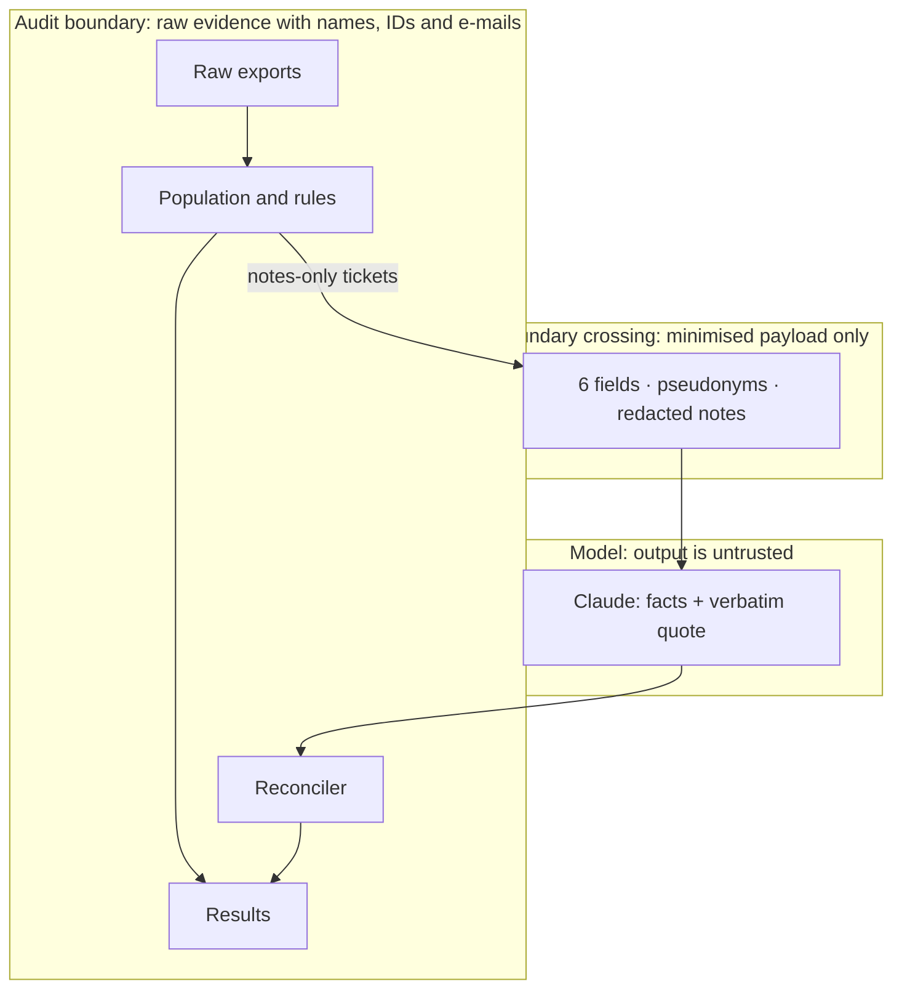

# Architecture

## Components

| Module | Responsibility | Trust level |
|---|---|---|
| `ingest.py` | Load the population from CSV exports or ServiceNow (GET only); hash every input; compare the Table API row count with the Aggregate API count | Inside the audit boundary |
| `controls.py` | Population filters and attribute tests for AC-01/02/03; reconcile model findings | Inside |
| `minimize.py` | Build the only payload that may leave the boundary: allow-listed fields, pseudonyms, redacted text | Boundary |
| `llm.py` | Ask a reviewer (Claude or offline rules) to extract approval facts from notes | **Outside**: treated as untrusted output |
| `evidence.py` | Write the workpaper, queues, LLM log, summary and manifest | Inside |
| `pilot.py` | Compare recommendations with an independent manual review | Inside |

## Data flow and trust boundaries

1. Raw data never leaves the boundary. Only the minimised payload crosses it (see [privacy.md](privacy.md)).
2. Model output is **data, not a decision**. The reconciler checks it again against facts known locally:
   the quote must be an exact substring of the notes that were sent, the approver pseudonym must be one of the two
   authorised pseudonyms computed locally, and the approval time must be no later than the grant time from the audit log.
3. Any item touched by the model ends as `NEEDS_REVIEW`. The model can raise a recommendation, but it cannot close an item.

## Result model

| Field | Meaning |
|---|---|
| `result` | `PASS` / `EXCEPTION` from rules alone, or `NEEDS_REVIEW` when a person must decide |
| `recommendation` | What the tool proposes to the tester (`PASS` or `EXCEPTION`); for rule-only items it equals `result` |
| `attributes` | Every attribute with Y / N / ? and a human-readable detail |
| `evidence_refs` | `audit:EV…`, `servicenow:RITM…`, `hr:U…`, `llm:EV…` pointers for re-performance |

## Design decisions

| Decision | Alternative considered | Reason |
|---|---|---|
| Rules first, model only for free text | Send every ticket to the model | Structured attributes need no judgment; rules are cheaper, faster and fully explainable to an auditor. About 3-5% of items need the model |
| Model extracts facts; code decides | Ask the model "did this pass?" | Keeps the control decision deterministic and re-performable; the model's job becomes checkable |
| Verbatim-quote check | Trust the model's summary | Catches invented evidence: a quote that is not in the notes sends the item to `EXCEPTION` |
| JSON schema output (`output_config.format`) | Free-text response plus parsing | Guarantees every response parses into the same fields; no regex on model prose |
| Server-side refusal fallback | Fail the item | A safety decline is retried on a fallback model in the same call; if the whole chain declines, the item goes to manual review |
| Offline reviewer | Require an API key for tests | CI and demos run with no network or credentials; the same reconciler and tests apply to both reviewers |
| SHA-256 manifest | Trust file names and dates | An auditor can prove which inputs produced which workpaper |
| Pseudonym salt per cycle | Fixed salt | Pseudonyms cannot be linked across cycles outside the boundary |
| Standard library only (core) | pandas | Easy to install on a locked-down audit workstation; `anthropic` is needed only for the Claude reviewer |

## Scaling notes

- The population for 10,000+ accounts per month is still only a few hundred to a few thousand **events**, which runs in seconds.
- For larger note volumes, the Claude calls are independent and can go through the Message Batches API (50% cost, asynchronous).
- The system prompt and schema are fixed for every call, so prompt caching applies when the volume makes it worthwhile.
